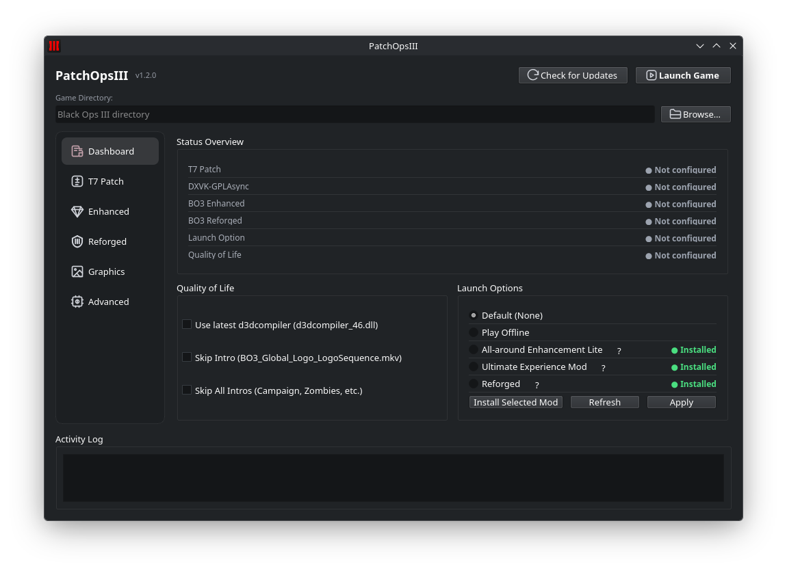
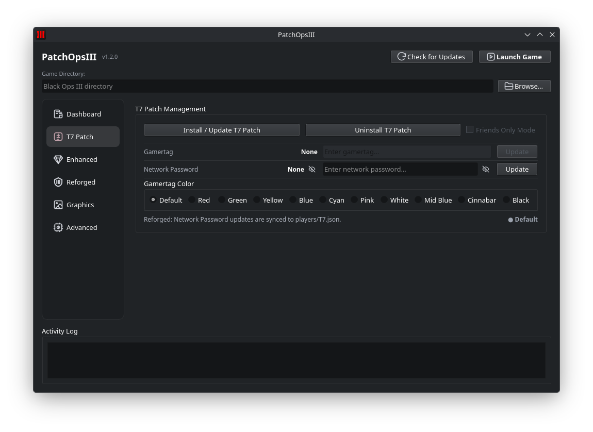
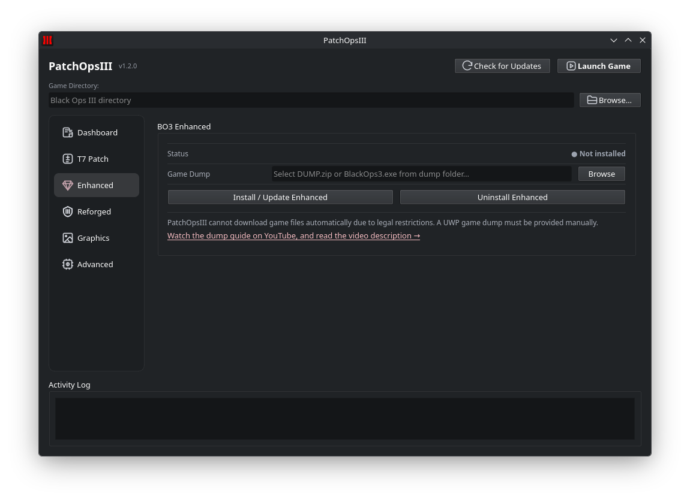
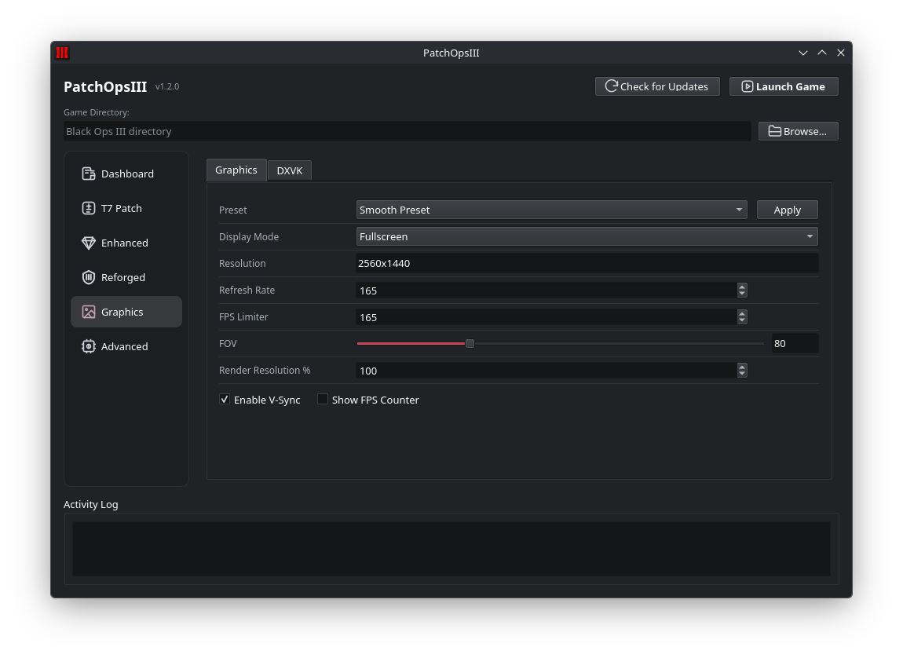
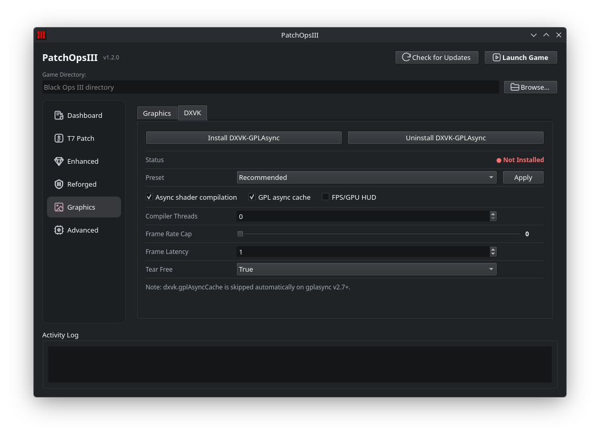
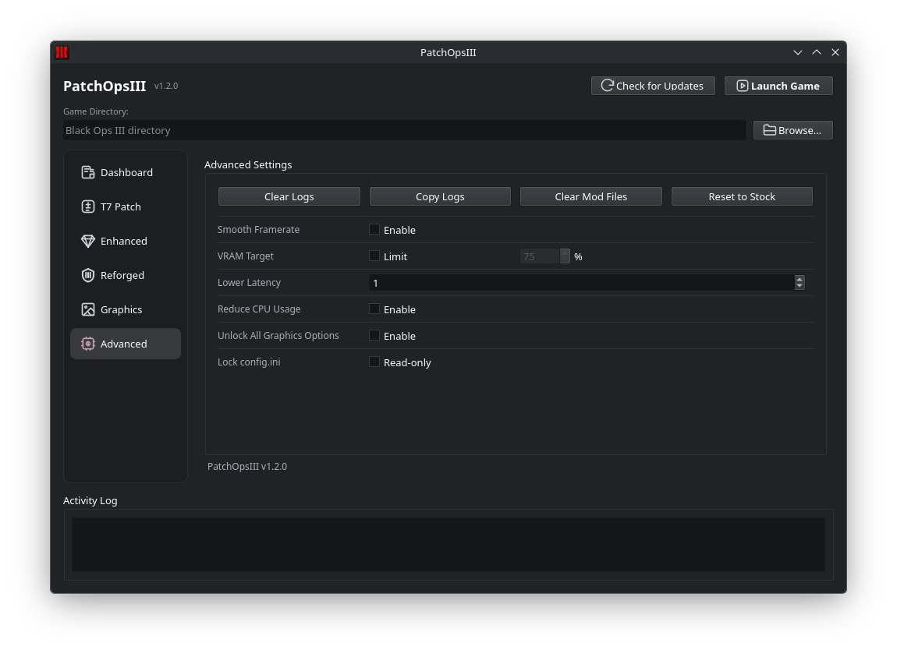

# PatchOpsIII

[](https://github.com/boggedbrush/PatchOpsIII/releases)
[](https://github.com/boggedbrush/PatchOpsIII/releases)
[](https://github.com/boggedbrush/PatchOpsIII/stargazers)
[](https://github.com/boggedbrush/PatchOpsIII/issues)
[](LICENSE)

> **PatchOpsIII** is a modern, full-featured control center for Call of Duty: Black Ops III modding, maintenance, and performance tuning.

---



---

## Table of Contents
- [Overview](#overview)
- [Key Features](#key-features)
  - [Mods Tab](#mods-tab)
  - [Graphics Tab](#graphics-tab)
  - [Advanced Tab](#advanced-tab)
  - [Terminal & Logging](#terminal--logging)
- [Installation](#installation)
- [Forked Components](#forked-components)
- [Quick Start](#quick-start)
- [Screenshots](#screenshots)
- [Known Issues](#known-issues)
- [Support](#support)
- [Special Thanks](#special-thanks)
- [License](#license)
- [Star History](#star-history)

## Overview
PatchOpsIII streamlines the setup and upkeep of Black Ops III by surfacing popular community tools and quality-of-life tweaks in a single polished native desktop app written in Rust (GPUI, with GPU-accelerated rendering) with no embedded browser or runtime. Whether you are securing your game with T7 Patch, smoothing shader compilation stutter with DXVK, or fine-tuning launch options, PatchOpsIII consolidates every workflow into one cohesive experience.

## Key Features

### Mods Tab
- **Smart Game Directory Detection:** Automatically locates your Black Ops III installation or lets you browse manually.
- **T7 Patch Management:** Install, update, configure gamertags and colors, apply network passwords, toggle Friends Only mode, deploy LPC fixes, and cleanly uninstall.
- **DXVK-GPLAsync Integration:** Deploy and remove Vulkan-based shader compilation to smooth frametimes by reducing shader cache stutter.
- **Workshop Helper:** One-click access to curated Steam Workshop mods and documentation.
- **Launch Profiles:** Preset command-line configurations for Default, Play Offline, [All-around Enhancement Lite](https://steamcommunity.com/sharedfiles/filedetails/?id=2994481309), and [Ultimate Experience Mod](https://steamcommunity.com/sharedfiles/filedetails/?id=2942053577).

### Graphics Tab
- **Preset Loader:** Apply curated JSON presets to instantly switch between visual configurations.
- **Convenience Sliders:** Tweak FOV, display mode, resolution, refresh rate, render resolution %, V-Sync, and FPS counters.
- **Intro Skip & FPS Limiter:** Automate `.mkv` renames and adjust FPS limits from 0–1000 for faster load times and smoother gameplay.

### Advanced Tab
- **Power Tweaks:** Toggle SmoothFramerate, unlock full VRAM usage, reduce CPU pressure, manage frame latency, and expose hidden graphics options by editing `config.ini` safely.
- **Stutter Fixes:** Automate DirectX DLL renaming to keep shader compilation modern and responsive.
- **Config Safeguards:** Set configuration files read-only to preserve your optimized setup.

### Terminal & Logging
- Embedded console view provides live feedback on every action.
- Automatic `PatchOpsIII.log` generation captures a detailed audit trail for troubleshooting and support.

## Installation
1. **Download:** Grab the latest release from the [Releases page](https://github.com/boggedbrush/PatchOpsIII/releases).
2. **Windows:** Run `PatchOpsIII.msi` (the installer), follow the prompts, then launch PatchOpsIII. The MSI upgrades earlier MSI installs in place. `PatchOpsIII.exe` is the same application as a single portable file (no installation) and is also kept for compatibility with older updaters. If you installed an older version with the previous `PatchOpsIII.exe` installer, uninstall it from Windows Settings → Apps after installing the MSI to avoid duplicate shortcuts; your settings and logs are kept.
3. **Linux & Steam Deck:** Download `PatchOpsIII.AppImage`, make it executable, then run it. A working Vulkan driver (present on Steam Deck and every mainstream desktop distro) and glibc 2.35 or newer (Ubuntu 22.04 or newer, SteamOS 3, Fedora, Arch, ...) are required.
4. **Dependencies:** None. The application is a single self-contained binary; there is nothing else to install.

### Developer Setup
PatchOpsIII is a Rust workspace: `crates/patchops-core` holds all application logic (config, Steam, T7 Patch, DXVK, BO3 Enhanced, EXE swapper, updater) and exposes it as a JSON op registry; `crates/patchops` is the [GPUI](https://crates.io/crates/gpui) desktop binary `patchops`. The toolchain is pinned in CI (see `RUST_TOOLCHAIN` in `.github/workflows/`); the workspace needs Rust 1.85 or newer. Do not run `cargo update`: `Cargo.lock` is committed and CI builds with `--locked`.

```bash
# run the desktop app (debug build)
cargo run -p patchops

# core logic only: unit tests, lints, and the parity suite (replays recorded legacy results against patchops-rpc)
cargo test -p patchops-core
cargo clippy -p patchops-core -p patchops --all-targets -- -D warnings
cargo build -p patchops-core --bin patchops-rpc && python3 tools/parity.py

# optimised build used for releases -> target/release/patchops
cargo build --release --locked -p patchops
```

**Linux build dependencies** (Debian/Ubuntu names): `build-essential pkg-config libx11-xcb-dev libxcb1-dev libxcb-render0-dev libxcb-shm0-dev libxcb-xkb-dev libxkbcommon-dev libxkbcommon-x11-dev libwayland-dev libfontconfig-dev libfreetype-dev`. At run time the app needs a Vulkan driver and an X11 or Wayland session; for headless testing use `xvfb-run -a` with Mesa's software Vulkan (`mesa-vulkan-drivers`).

**Windows build requirements:** the MSVC toolchain (`x86_64-pc-windows-msvc`, Visual Studio Build Tools with the "Desktop development with C++" workload) and the Windows 10/11 SDK. GPUI compiles its HLSL shaders with `fxc.exe` from the SDK; if it is not on `PATH` set `GPUI_FXC_PATH` to it. Details in [crates/patchops/GPUI_NOTES.md](crates/patchops/GPUI_NOTES.md).

**Packaging** (AppImage, MSI and portable EXE, tool pins and the layout the app expects) is described in [packaging/README.md](packaging/README.md). The release workflows read the app version from `[workspace.package] version` in the root `Cargo.toml`.

## Forked Components
- **BO3 Enhanced Proton fork metadata:** [bo3-enhanced-proton/README.md](bo3-enhanced-proton/README.md)
  - Upstream source: https://github.com/Weather-OS/GDK-Proton
  - Current base release: `release10-32`
  - Local `bo3-enhanced-proton/BO3 Enhanced` content is optional for development/offline workflow and is intentionally gitignored.
  - Normal Linux installs do not require this local bundle; PatchOpsIII downloads and caches the upstream release on demand.

## Quick Start
1. Launch PatchOpsIII and verify your Black Ops III directory.
2. Apply the **T7 Patch** to secure multiplayer connectivity and remove RCE vulnerabilities.
3. Enable **DXVK-GPLAsync** for async shader compilation and smoother frametimes.
4. Choose a graphics preset or dial in custom display options.
5. Visit the **Advanced** tab to unlock VRAM, tweak frame latency, and set your config to read-only once satisfied.

## Screenshots
<table>
  <tr>
    <td align="center"><br/><sub>Dashboard</sub></td>
    <td align="center"><br/><sub>T7 Patch</sub></td>
  </tr>
  <tr>
    <td align="center"><br/><sub>Enhanced</sub></td>
    <td align="center"><br/><sub>Graphics</sub></td>
  </tr>
  <tr>
    <td align="center" colspan="2"><br/><sub>DXVK</sub></td>
  </tr>
  <tr>
    <td align="center" colspan="2"><br/><sub>Advanced</sub></td>
  </tr>
</table>

## Known Issues
- Full version of the [All-around Enhancement Mod](https://steamcommunity.com/sharedfiles/filedetails/?id=2631943123) currently crashes before the game finishes launching, so it is not exposed as a launch option in PatchOpsIII.
- Launch option stability can vary between systems; experiment to find a stable configuration.
- A few advanced toggles remain in beta testing—report issues via GitHub.

## Support
- 📚 Explore detailed usage notes in the [project wiki](wiki/home.md).
- 🐛 Report bugs or request features through [GitHub Issues](https://github.com/boggedbrush/PatchOpsIII/issues).
- 💬 Join the community discussion on Discord *(coming soon)*.

## Special Thanks
This project would not be possible without the incredible work of the broader community:

- **t7patch** – Security and stability backbone for Black Ops III multiplayer.  
  Original work by `shiversoftdev`, continued by `Scroptss`: [https://github.com/Scroptss/T7Patch](https://github.com/Scroptss/T7Patch)
- **dxvk-gplasync** – Vulkan translation layer with async shader compilation.  
  [https://gitlab.com/Ph42oN/dxvk-gplasync](https://gitlab.com/Ph42oN/dxvk-gplasync)
- **ValvePython/vdf** – Reliable Steam VDF parsing utilities used throughout PatchOpsIII.  
  [https://github.com/ValvePython/vdf](https://github.com/ValvePython/vdf)

## License
PatchOpsIII is released under the [MIT License](LICENSE).

## Star History
[](https://star-history.com/#boggedbrush/PatchOpsIII&Date)
